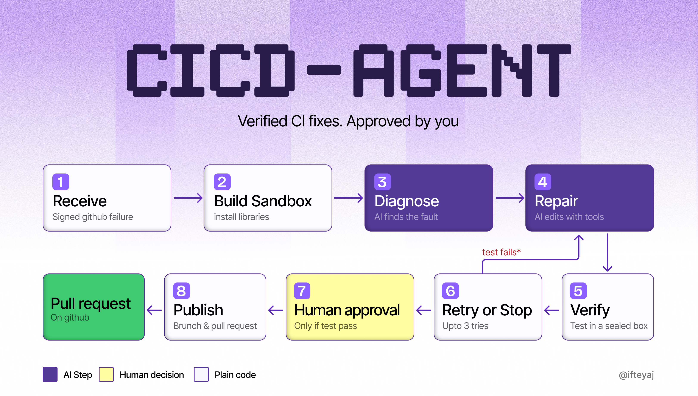

# agentic-cicd

Verified CI-fix agent: when a GitHub Actions run fails, it triages the failure, proposes a
patch, validates that patch in a sandbox, and waits for a human approval gate before
publishing anything. Nothing is auto-merged.

The installable Python package and CLI inside this repository are called **`cicd-agent`**.

## Status

Milestone 1 — walking skeleton implemented. The service exposes:

- `GET /healthz` — liveness.
- `POST /webhooks/github` — verifies the `X-Hub-Signature-256` HMAC over the
  raw body, accepts only failed (`failure`/`timed_out`) completed
  `workflow_run` events, and creates exactly one queued run per delivery ID and
  per signed `workflow_run.id:run_attempt`.

Implemented in M1:

- Run states enforced by `transition()` (15 legal transitions).
- Pause at `AWAITING_APPROVAL`; a run survives a restart via the SQLite run row.
- Approval endpoint with patch-hash check (wrong hash and terminal runs return 409).
- Three failed validation attempts escalate the run.
- Events table with database-assigned IDs, SSE replay with `Last-Event-ID`.
- Payload redaction before storage and a CLI welcome screen.

Still planned: sandbox execution, triage, patch generation, and publishing.
A valid approval currently returns `501` because publishing is not implemented.

## Webhook intake

Configure a secret and start the API:

```bash
cd api
export GITHUB_WEBHOOK_SECRET="$(python -c 'import secrets; print(secrets.token_urlsafe(32))')"
uv run uvicorn app.main:app --reload
```

The secret must not be blank or `change-me`; otherwise every delivery returns
`503`. Point a GitHub webhook at
`http://127.0.0.1:8000/webhooks/github` with content type `application/json`
and the `workflow_run` event.

| Response | Meaning |
| --- | --- |
| `202` | New run created (`{"run_id", "duplicate": false}`) |
| `200` | Duplicate delivery or workflow attempt (`duplicate: true`) |
| `204` | Event or conclusion ignored |
| `400` | Malformed JSON |
| `401` | Missing or invalid signature |
| `413` | Body over 1 MiB |
| `422` | Missing/invalid header or field |
| `503` | Webhook secret not configured or unusable |

M1 is single-process: deduplication is in memory and resets on restart. Do not
run multiple workers.

## Layout

```
api/                FastAPI service, tests, and Python project (cicd-agent)
  app/
    domain/         Status machine and core domain types
    services/       Run orchestration, stores
    routes/         HTTP endpoints
    security/       Webhook signature verification
fixtures/           Seeded-bug repositories used to evaluate the agent
eval/               Evaluation harness and corpus
prompts/            Agent prompts
docs/               ADRs, setup, security notes
docker/             Docker support files
```

## Quickstart

Requires Python 3.12 and [uv](https://docs.astral.sh/uv/).

```bash
cd api
uv sync
uv run pytest
uv run uvicorn app.main:app --reload
```

Then `curl http://127.0.0.1:8000/healthz` should return `{"status":"ok"}`.

## Docker

```bash
docker compose up --build
```

The API is published on `127.0.0.1:8000` only.

## Quality gates

```bash
cd api
uv run ruff check .
uv run ruff format --check .
uv run mypy
uv run pytest -q
```

These are the same checks CI runs on every push and pull request.

## Licence

MIT. See [LICENSE](LICENSE).
